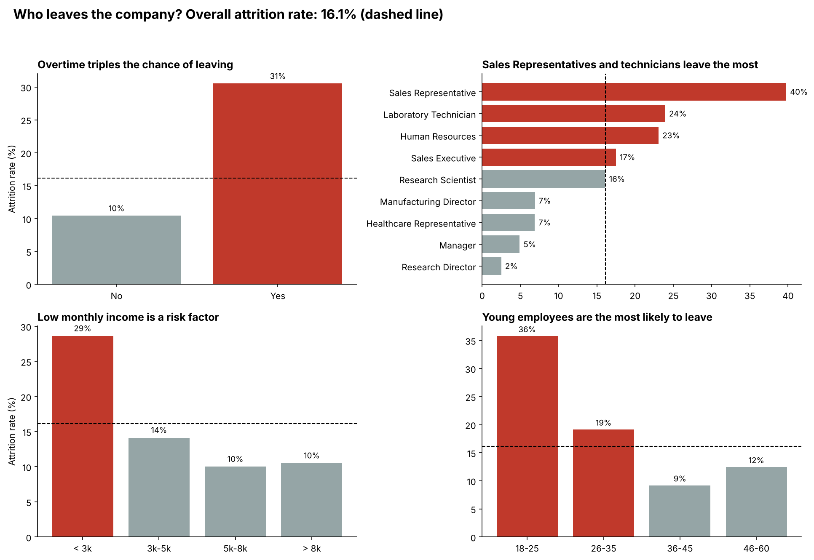
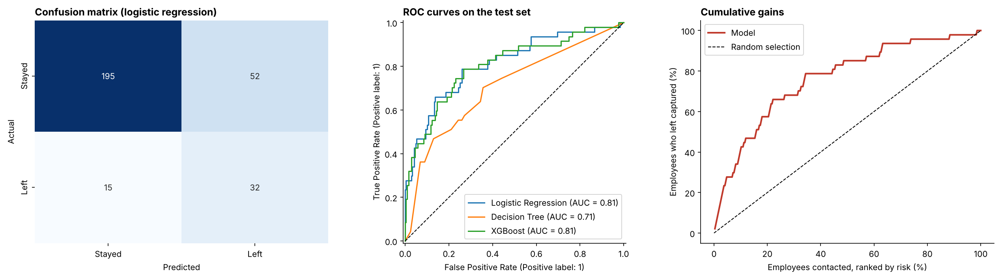
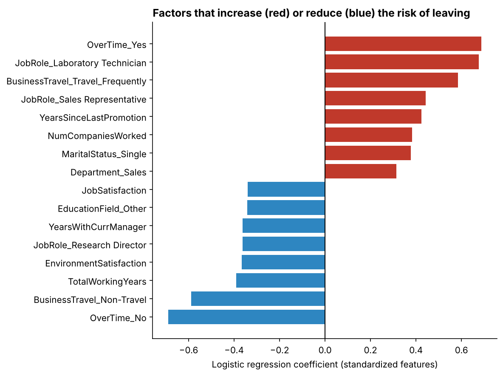

# Employee Attrition: Predicting Who Is Likely to Leave

A machine learning project that ranks employees by risk of leaving a company and identifies the factors associated with attrition. Built as the final project of the EBAC Data Scientist course, in partnership with Semantix.



## Business problem

Losing an employee is expensive: recruiting, onboarding and the loss of experience add up, and high turnover also hurts the remaining team. HR usually finds out someone is leaving only when the resignation arrives, when it is too late to act.

**Question:** which employees have the highest risk of leaving, and which factors are associated with it?

**Why data and Machine Learning help:** companies already store information about each employee (role, income, overtime, satisfaction, tenure). A model can learn the combination of factors that separates people who left from people who stayed, rank current employees by risk and let HR focus a limited retention budget on the right people. Descriptive analysis alone cannot produce this ranking because many factors act together.

**Target:** `Attrition` (1 = left, 0 = stayed). Binary classification with imbalanced classes (16.1% of employees left).

## Data collection

| Item | Description |
|---|---|
| Dataset | IBM HR Analytics Employee Attrition & Performance |
| Source | [IBM/employee-attrition-aif360](https://github.com/IBM/employee-attrition-aif360) on GitHub (`data/emp_attrition.csv`), also available on Kaggle |
| Nature | Fictional dataset created by IBM data scientists for educational purposes: no real employees, no confidential information |
| Size | 1,470 employees, 35 columns (demographics, job information, income, satisfaction scores, tenure) |
| Quality | No missing values, no duplicated rows. Three constant columns and the employee identifier were removed |

A copy of the file is stored in `data/hr_employee_attrition.csv` to make the project reproducible.

## Exploratory data analysis

- Employees working overtime leave at **30.5%**, against **10.4%** of those who do not.
- **Sales Representatives** have the highest turnover by role (**39.8%**); Managers and Research Directors are the most stable (below 5%).
- Turnover is highest among the youngest (**35.8%** up to 25 years old) and the lowest paid (**28.6%** below 3k a month).
- Single employees (25.5%), frequent travelers (24.9%) and people with no stock options (24.4%) also leave more.

## Modeling

**Setup**

- Stratified 80/20 train/test split (`random_state=42`) made before any fitting. The test set is used only once, at the end.
- Scaling and one-hot encoding live inside a scikit-learn `Pipeline`, so they are fitted only on the training folds: no data leakage.
- Class imbalance handled with `class_weight='balanced'` and `scale_pos_weight`. SMOTE was not needed for a 16% minority class.
- Accuracy is not used (always predicting "stayed" gives 84%). Metrics: ROC-AUC, PR-AUC, recall, precision and F1.

**Models:** Logistic Regression, Decision Tree and XGBoost, compared against a dummy baseline. Hyperparameters tuned with grid/randomized search, using stratified 5-fold cross-validation on the training set.

| Model | CV ROC-AUC (default) | CV ROC-AUC (tuned) | Test ROC-AUC | Test PR-AUC | Test recall | Test precision |
|---|---|---|---|---|---|---|
| Baseline (dummy) | 0.500 | - | - | - | - | - |
| **Logistic Regression** | 0.827 | **0.831** | **0.812** | 0.588 | 0.681 | 0.381 |
| Decision Tree | 0.626 | 0.724 | 0.708 | 0.331 | 0.553 | 0.289 |
| XGBoost | 0.799 | 0.824 | 0.805 | 0.562 | 0.638 | 0.455 |

Logistic Regression was selected using only the cross-validation results. The test metrics use a 0.5 threshold.



- The model finds **32 of the 47 employees who left** in the test set (recall 68%).
- Contacting only the **20% highest-risk employees captures about 57% of all leavers** (random selection would capture 20%).



## Conclusions

1. Attrition can be ranked with a simple, explainable model: logistic regression reached a test ROC-AUC of 0.81, consistent with the cross-validation (0.83).
2. Overtime is the strongest and most actionable factor. Reviewing workloads, especially for Sales Representatives and Laboratory Technicians, is the first recommended action. Frequent business travel and a long time since the last promotion are also associated with higher risk.
3. A more complex model did not help. After tuning, XGBoost was practically tied with logistic regression, and a single decision tree was clearly worse. On small tabular datasets, simple models should be tried first.

**Limitations**

- The dataset is fictional and small (237 leavers, only 47 in the test set), so the metrics have a wide margin of error.
- The data is a single snapshot: the model finds associations, not causes.
- The data includes `Age`, `Gender` and `MaritalStatus`. In a real use they could lead to unfair or illegal decisions. The model should guide support actions for groups of employees, never penalize an individual, and would need a fairness review and a LGPD/GDPR assessment before deployment.
- The 0.5 threshold is arbitrary; in practice it should be set with HR from the cost of a retention action against the cost of losing an employee.

**Next steps:** calibrate the probabilities, choose the threshold from cost estimates, validate on real attrition data and test the model on a later period.

## Repository structure

```
.
├── README.md
├── requirements.txt
├── data/
│   └── hr_employee_attrition.csv
├── images/
│   ├── attrition_drivers.png
│   ├── model_results.png
│   └── risk_factors.png
└── notebooks/
    └── employee_attrition.ipynb
```

## How to run

```bash
git clone https://github.com/lumagnani/EmployeeAttrition.git
cd EmployeeAttrition
pip install -r requirements.txt
jupyter notebook notebooks/employee_attrition.ipynb
```

Run the notebook from the `notebooks/` folder, since the paths are relative (`../data`, `../images`).

## Author

Luiza Magnani - [GitHub](https://github.com/lumagnani)
